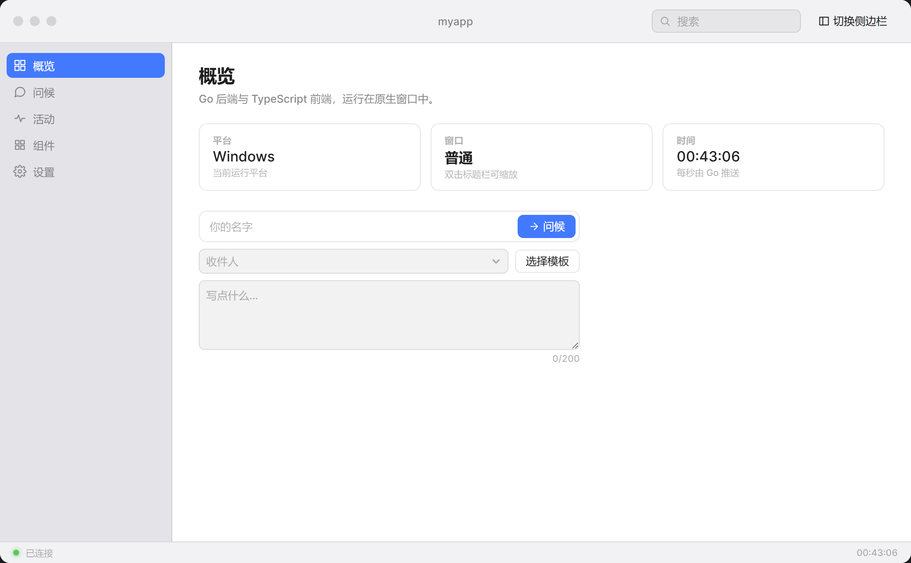

# macOS UI Kit for Wails

A **macOS-styled desktop application** built with Go and [Wails v3](https://v3.wails.io/),
containing a self-contained **vanilla TypeScript component library** — no React, no Vue,
no framework runtime.

The window is frameless: the app paints its own title bar, traffic lights and sidebar,
so the interface looks the same on Windows, macOS and Linux, and adapts to touch devices.

<!-- Replace with a screenshot of your build -->


---

## What this is

Two things in one repository:

1. **An application** — a working Wails v3 desktop app with a frameless window,
   custom macOS chrome, a native menu bar, and a live component showcase.
2. **A component library** — `frontend/src/ui/`, 30 components on two-layer design
   tokens with a runtime theme system. It has no Wails dependency, so it can be
   lifted into another project or tested in a plain browser.

---

## The component library

**30 components**, all themeable and usable on desktop and touch:

| Group | Components |
| --- | --- |
| **Controls (17)** | Button, TextField, TextArea, NumberField, Slider, Progress, Spinner, Badge, Switch, Checkbox, SegmentedControl, Select, ComboBox, DatePicker, Disclosure, Table, SplitView |
| **Layout (6)** | TitleBar, TrafficLights, Sidebar, StatusBar, Toolbar, TabView |
| **Overlays (6)** | Menu, Tooltip, Dialog, Popover, Sheet, Toast |
| **Mobile (1)** | MobileShell |

Open the app and pick **组件** in the sidebar to see all 30 rendered live and
interactive, with theme and density switches at the top.

### Why no framework

The kit targets a window shell with light interaction — settings panels, lists,
forms. That is exactly the workload where a framework's runtime cost is pure
overhead and its benefits (virtual DOM diffing for large, frequently-updated
lists) go unused. The trade-off is that state synchronisation and event
delegation are manual, which is why the library enforces rules like delegated
listeners, `DocumentFragment` insertion and idempotent setters.

Read [DESIGN-v2.md](frontend/src/ui/DESIGN-v2.md) for the full architecture and
the reasoning behind each decision, including what was rejected and why.

### Two-layer tokens

```
base layer       raw values       --mac-base-gray-950  --mac-base-blue-D
     ↓
semantic layer   purpose names    --mac-bg-window  --mac-accent
     ↓
components       read only these  background: var(--mac-bg-window)
```

Components never reference a base token. That indirection is what lets a theme
override three values instead of sixty.

### Theming

```ts
import {themeManager} from "./ui";

themeManager.register({
  name: "brand",
  appearance: "dark",              // inherit the dark palette
  tokens: {
    accent: "#ff6b35",
    "bg-window": "#141018",
  },
});
themeManager.apply("brand");
```

Built-in appearances: `macos-dark`, `macos-light`, `hc-dark`, `hc-light`.
The default follows the OS setting with **pure CSS**, so the first paint is
already correct — no flash of the wrong theme.

**Density** presets (`compact` / `comfortable` / `touch`) move a single
`--mac-scale` factor that every scalable dimension multiplies. Touch devices get
the roomier density automatically, and 44 px tap targets are enforced where the
pointer is coarse.

---

## Getting started

**Requirements:** Go 1.26+, Node 18+, the `wails3` CLI, and the platform webview
(WebView2 on Windows, WebKit on macOS, WebKitGTK on Linux).

```sh
# Run in development, with hot reload
wails3 dev

# Build a production binary into bin/
wails3 build
```

### Type checking

```sh
cd frontend && npm run typecheck
```

TypeScript must be 5.0 or newer: `tsconfig.json` uses `moduleResolution: "bundler"`
and `verbatimModuleSyntax`, which older compilers reject.

### Regenerating bindings

The files in `frontend/bindings/` are generated from the Go services. Regenerate
them after changing an exported service method:

```sh
wails3 generate bindings -f "-tags production" -clean=true -ts -i
```

`wails3 build` runs this automatically.

---

## How the window works

The window is frameless (`Frameless: true`) with the native title bar hidden. The
app draws the whole frame, which is what makes the interface identical across
platforms.

| macOS element | Where it lives |
| --- | --- |
| Traffic lights | `frontend/src/ui/layout/traffic-lights.*` |
| Draggable title bar | `.mac-titlebar` via the `--wails-draggable: drag` property |
| Source-list sidebar | `frontend/src/ui/layout/sidebar.*` |
| Toolbar search | `TextField` in the title bar's trailing cluster |
| Status bar | `frontend/src/ui/layout/statusbar.*` |

`windowservice.go` exposes window control to the frontend; its exported methods
become promise-returning TypeScript functions. Because there is no native frame
to fall back on, the rendered traffic lights are the window's only close,
minimise and zoom controls.

The service also listens for native window events and pushes state through
`window:state`, so the lights stay correct when the window is changed from
outside the app — double-clicking the title bar, for instance.

### Platform differences, stated honestly

| Concern | Reality |
| --- | --- |
| **Fonts** | macOS/iOS use the real SF Pro via `-apple-system`. Windows/Linux fall back to **Inter** (SIL OFL), which is drawn to be SF-like. Exact glyph parity is impossible: SF Pro is Apple-licensed and cannot be redistributed. |
| **Rendered chrome** | Layout, spacing, radii and colour are identical. Scrollbar rendering and native form-control defaults differ per engine; the kit replaces the ones that matter. |
| **Menu bar** | macOS has a system-wide menu bar that cannot be drawn in the webview, so `menu.go` defines a native one (⌘Q, ⌘W, ⌘M, ⌘,). Windows/Linux disable it and use the sidebar. **No platform shows two navigation surfaces.** |
| **Window corners** | On macOS AppKit already rounds a frameless window, so the CSS corner steps aside there to avoid a double edge. Windows/Linux draw their own. |
| **Mobile** | The mobile shell targets *usability* — safe areas, 44 px targets, no hover dependence — not pixel parity with iOS HIG. The two design systems differ by intent. |

---

## Project layout

```
main.go                  application and window setup
menu.go                  native application menu bar
windowservice.go         window control service + window:state event
greetservice.go          demo Go service the frontend calls

frontend/
├─ index.html            document shell (an empty #app mount point)
├─ public/style.css      app-level layout (the kit supplies the rest)
└─ src/
   ├─ main.ts            shell wiring: traffic lights, sidebar, events
   ├─ ui/                THE COMPONENT LIBRARY
   │  ├─ tokens.css        two-layer design tokens
   │  ├─ base.css          global element rules ([hidden], .visually-hidden)
   │  ├─ theme.ts          runtime theme manager
   │  ├─ fonts.css         cross-platform font normalisation
   │  ├─ scrollbars.css    cross-platform scrollbar normalisation
   │  ├─ touch.css         no-hover normalisation
   │  ├─ component.ts      base class (listener lifetime)
   │  ├─ dom.ts            element builders
   │  ├─ overlay.ts        positioning, focus trap, z-index
   │  ├─ controls/         17 controls
   │  ├─ layout/           6 layout components
   │  ├─ overlays/         6 overlays
   │  └─ mobile/           mobile shell
   ├─ showcase/          live component showcase
   └─ bindings/          GENERATED — do not edit
```

### Where each component is used

The demo application exercises the whole library rather than only showing it off
in one gallery pane, because a component that is only ever rendered in a
catalogue tends to be wrong in ways a catalogue cannot reveal:

| Pane | Components it puts to work |
|---|---|
| Overview | `TextField`, `Button`, `ComboBox`, `TextArea`, `Menu`, `Tooltip`, `Badge` |
| Greeting | the message history list, fed by the same controls as Overview |
| Activity | `SegmentedControl`, `Table`, `Badge`, `Spinner`, `Progress`, `Button` |
| Settings | `TabView`, `SegmentedControl`, `Slider`, `Checkbox`, `Switch`, `Select`, `NumberField`, `DatePicker`, `Disclosure`, `Dialog` |
| Components | all 30 in the showcase, plus `Toolbar`, `SplitView`, `Popover`, `Sheet` in a composed inspector |

`TrafficLights` is created by `TitleBar` rather than by application code, and
`Toast` is raised through `showToast()`, so neither appears as a `new` call in
`main.ts`.

---

## Verification

Every change to this repository is checked with:

```sh
go vet ./...
gofmt -l *.go
cd frontend && npx tsc --noEmit && npm run build
wails3 build
```

The component library is additionally verified by instantiating **all 30
components in a real headless browser** and asserting each mounts with the
correct root class — a component can type check and still render nothing.

The harness also asserts behaviour, not just presence: that `Table.setRows()`
re-renders, that `Progress.setValue()` moves the fill, that `TabView.select()`
changes the selected tab, that `Disclosure` toggles its open state, that all four
themes produce different background colours, and that the density presets change
`--mac-scale`.

Two of those checks are regression tests for defects the harness caught and the
catalogue alone could not:

- **`[hidden]` was being ignored.** A component root that sets `display` beats
  the user-agent `[hidden] { display: none }` rule, so `element.hidden = true` on
  a `Spinner` left it visible. Four components had each worked around this
  locally for an inner part; `base.css` now fixes the category.
- **The `Disclosure` chevron pointed the wrong way.** The icon path draws a
  right-pointing chevron at `0deg`, but the stylesheet rotated it `-90deg` when
  collapsed (pointing *up*) and `0deg` when open (pointing *right*). Collapsed is
  now `0deg` and open is `90deg`, matching the macOS convention.

---

## Licence

Application code in this repository is provided as-is for reference and reuse.
Bundled third-party assets keep their own licences:

- **Inter** typeface — SIL Open Font License 1.1 (see `frontend/Inter Font License.txt`)
- **Wails** — MIT
