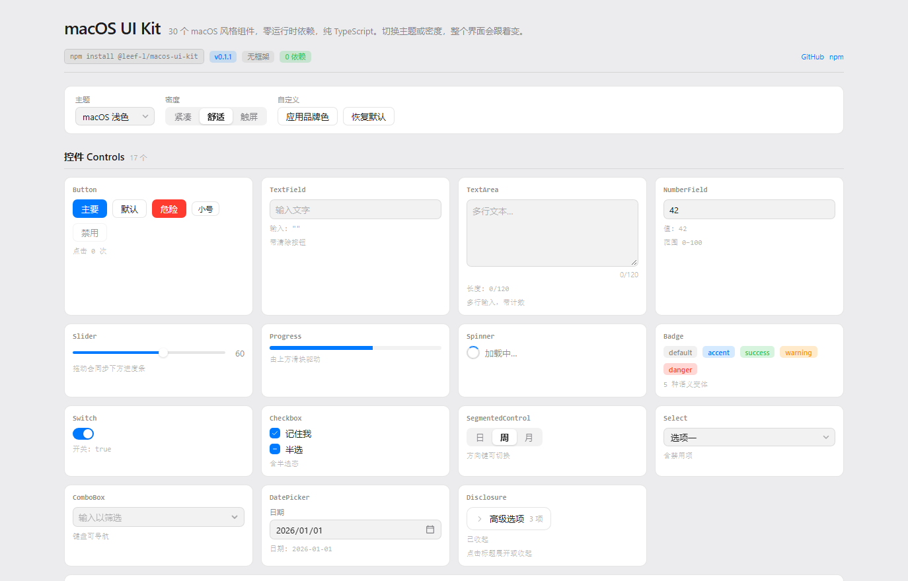
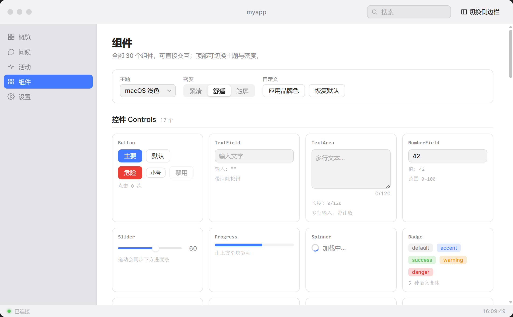

# macOS UI Kit

**30 macOS-style components in dependency-free TypeScript.** No React, no Vue,
no virtual DOM — just DOM APIs over two-layer design tokens, with runtime theming
and density scaling.

**Standalone: no Wails, no Go, no backend, no framework.** It runs in any browser
tab on its own — Wails is a supported target, not a requirement.

**Live preview → <https://leef-l.github.io/macos-ui-kit/>**

[](https://www.npmjs.com/package/@leef-l/macos-ui-kit)
[](https://leef-l.github.io/macos-ui-kit/)
[](./LICENSE)

**English** | [简体中文](./README.zh-CN.md)



---

## Quick start

```sh
npm install @leef-l/macos-ui-kit
```

```ts
import {Button, TextField, showToast} from "@leef-l/macos-ui-kit";
// The JS bundle contains no CSS; the stylesheet is a separate import.
import "@leef-l/macos-ui-kit/style.css";

const field = new TextField({placeholder: "Your name"});
document.body.appendChild(field.element);

const button = new Button({
    label: "Greet",
    variant: "primary",
    onClick: () => showToast(`Hello ${field.value}`),
});
document.body.appendChild(button.element);
```

Every component exposes `element`, the node you mount. Construct it, append
`element`, keep the instance for the methods.

### No build tooling at all

Take `dist/macos-ui-kit.iife.js`, `dist/macos-ui-kit.css` and `dist/assets/` from
a [release](https://github.com/leef-l/macos-ui-kit/releases), put them next to your
HTML, and use the global `MacUI`:

```html
<link rel="stylesheet" href="./macos-ui-kit.css" />
<script src="./macos-ui-kit.iife.js"></script>
<script>
    document.body.appendChild(
        new MacUI.Button({label: "Hello", variant: "primary"}).element,
    );
</script>
```

### Other install channels

| Channel | Command | Notes |
|---|---|---|
| **npm** | `npm install @leef-l/macos-ui-kit` | Recommended. No config, no token. |
| **Release tarball** | `npm install https://github.com/leef-l/macos-ui-kit/releases/download/v0.1.2/leef-l-macos-ui-kit-0.1.2.tgz` | Pins an exact build; no registry involved. |
| **GitHub Packages** | `npm install @leef-l/macos-ui-kit` with `@leef-l:registry=https://npm.pkg.github.com` | Requires a token **even though the package is public**. |

See [`packages/macos-ui-kit/README.md`](packages/macos-ui-kit/README.md) for the
package-level documentation.

---

## Scope: frontend only

This package is **UI components and nothing else** — no backend, no server, no
data layer, no code generation.

- **No Go, no Wails runtime.** `package.json` declares no `dependencies` and no
  `peerDependencies`; the built bundle has no imports at all. Nothing in `src/`
  reads a `_wails` global, an IPC bridge or a native API.
- **No framework.** Just DOM APIs. It runs in any browser, in an Electron or
  Tauri webview, in a Wails window, or in an HTML file opened from disk.
- **No network calls.** Components never fetch anything.

Wails v3 is a *target*, not a requirement. Where the kit touches host behaviour it
uses standard web APIs, which degrade to nothing outside a desktop shell:

| Behaviour | How | Outside a desktop shell |
|---|---|---|
| Window dragging | `--wails-draggable` CSS property on the title bar | Ignored |
| Double-click to zoom | `dblclick` listener | Does nothing |
| Mobile detection | `matchMedia("(pointer: coarse)")` | Works everywhere |
| Sidebar / overlays | Plain DOM + CSS | Works everywhere |

The Go code in this repository is a **demo host**, not part of the package.

| | Ships to consumers | Needs Go | Needs Wails |
|---|---|---|---|
| `packages/macos-ui-kit` | yes | no | no |
| The demo app | no | yes | yes |

### The same components in a real desktop window

Opting into Wails costs you nothing beyond the host: the window below is the same
component code, running in a frameless WebView2 window with a rendered title bar,
traffic lights, sidebar and status bar. Nothing in the library changed to make
this work.



---

## Components

| Group | Components |
| --- | --- |
| **Controls (17)** | Button, TextField, TextArea, NumberField, Slider, Progress, Spinner, Badge, Switch, Checkbox, SegmentedControl, Select, ComboBox, DatePicker, Disclosure, Table, SplitView |
| **Layout (6)** | TitleBar, TrafficLights, Sidebar, StatusBar, Toolbar, TabView |
| **Overlays (6)** | Menu, Tooltip, Dialog, Popover, Sheet, Toast |
| **Mobile (1)** | MobileShell |

Try them at <https://leef-l.github.io/macos-ui-kit/> — theme and density switches
are at the top of that page.

## API convention

Three rules across all 30 components, so a control you have never used behaves
the way you would guess:

| Concern | Rule | Examples |
|---|---|---|
| **Read state** | property getter | `field.value`, `toggle.checked`, `sidebar.selected`, `sheet.isOpen` |
| **Write state** | `setX()`, always silent | `setValue()`, `setChecked()`, `setSelected()` |
| **Dismissible overlays** | `open(anchor?)` / `close()` / `isOpen` | `dialog.open()`, `menu.open(btn)`, `popover.open(btn)` |

```ts
const field = new TextField();
field.setValue("hello");   // silent: does not fire onChange
field.value;               // "hello"

const sheet = new Sheet({title: "Licence"});
sheet.open();              // not show()
sheet.isOpen;              // true
```

Two deliberate details:

- **`setX()` never fires the change callback** — only a user interaction does.
  That makes programmatic writes safe from a render path: they cannot loop back
  into your handler.
- **`Toast` keeps `show()` / `hide()`.** It is a notification, not an overlay: no
  anchor, no dismissal state, no `isOpen`.

Every component also exposes `element`, `destroy()` (releases listeners and any
observer), and `focus()` where focusing makes sense.

## Theming

```ts
import {themeManager, setDensity} from "@leef-l/macos-ui-kit";

themeManager.apply("macos-dark");   // macos-dark | macos-light | hc-dark | hc-light
setDensity("compact");              // compact | comfortable | touch
```

Or override tokens in your own stylesheet — components read semantic tokens only,
so one declaration restyles everything:

```css
:root {
    --mac-accent: #7c5cff;
    --mac-radius-m: 10px;
}
```

### Two-layer tokens

```
base layer       raw values       --mac-base-gray-950  --mac-base-blue-D
     ↓
semantic layer   purpose names    --mac-bg-window  --mac-accent
     ↓
components       read only these  background: var(--mac-bg-window)
```

Components never reference a base token. That indirection is what lets a theme
override three values instead of sixty.

Built-in appearances are pure CSS, so the first paint is already correct — no
flash of the wrong theme. Density presets move a single `--mac-scale` factor that
every scalable dimension multiplies; coarse pointers get the roomier preset
automatically.

### Why no framework

The kit targets a window shell with light interaction — settings panels, lists,
forms. That is exactly the workload where a framework's runtime cost is pure
overhead and its benefits (virtual-DOM diffing for large, frequently-updated
lists) go unused. The trade-off is manual state sync and event delegation, which
is why the library enforces delegated listeners, `DocumentFragment` insertion and
idempotent setters.

Read [`DESIGN-v2.md`](packages/macos-ui-kit/src/DESIGN-v2.md) for the full
architecture and the reasoning behind each decision, including what was rejected.

---

## Preview site

<https://leef-l.github.io/macos-ui-kit/>

The showcase runs in a plain browser with no Go, no Wails and no bundler at
runtime. It is built from the same source as the library:

| File | Role |
|---|---|
| `frontend/preview/index.html` | page shell |
| `frontend/src/preview.ts` | mounts `buildShowcase()` plus a masthead and footer |
| `frontend/src/preview.css` | page frame, token-only |
| `frontend/vite.preview.config.ts` | its own Vite root; `base` is `/macos-ui-kit/` |
| `.github/workflows/preview.yml` | install → typecheck → build → deploy to Pages |

`preview.ts` imports the kit **by package name**, so the page doubles as proof
that the library stands alone. It is rebuilt on every push to `main` and can be
triggered by hand from the Actions tab.

---

## Repository layout

```
packages/macos-ui-kit/   THE COMPONENT LIBRARY (published package)
├─ package.json          name, exports map, build scripts, files list
├─ vite.config.ts        library build: ESM + IIFE + one stylesheet
├─ tsconfig.build.json   declaration emit only
├─ assets/               Inter font + its OFL licence
├─ scripts/
│  └─ finalize-dist.mjs  post-build: externalise the font, write style.css.d.ts
└─ src/
   ├─ tokens.css         two-layer design tokens
   ├─ base.css           global element rules ([hidden], .visually-hidden)
   ├─ theme.ts           runtime theme manager
   ├─ fonts.css          cross-platform font normalisation
   ├─ scrollbars.css     cross-platform scrollbar normalisation
   ├─ touch.css          no-hover normalisation
   ├─ component.ts       base class (listener lifetime)
   ├─ dom.ts             element builders
   ├─ overlay.ts         positioning, focus trap, z-index
   ├─ controls/          17 controls
   ├─ layout/            6 layout components
   ├─ overlays/          6 overlays
   └─ mobile/            mobile shell

frontend/                THE DEMO APP (Wails v3, not published)
├─ preview/             static preview entry for Pages
├─ index.html           document shell for the desktop window
├─ public/style.css     app-level layout
└─ src/
   ├─ main.ts           shell wiring: traffic lights, sidebar, events
   ├─ preview.ts        preview page entry
   ├─ showcase/         live component showcase
   └─ bindings/         GENERATED — do not edit

main.go                 application and window setup
menu.go                 native application menu bar
windowservice.go        window control service + window:state event
greetservice.go         demo Go service the frontend calls
```

### Why the app imports source, not `dist`

`frontend/vite.config.ts` aliases `@leef-l/macos-ui-kit` to
`packages/macos-ui-kit/src/index.ts`, and `frontend/tsconfig.json` maps the same
path under `paths`. Editing a component takes effect on reload with no library
build step, and there is never a second copy of the code to drift. Consumers
outside this repository use the built package.

---

## The demo app

**Requirements:** Go 1.26+, Node 18+, the `wails3` CLI, and the platform webview
(WebView2 on Windows, WebKit on macOS, WebKitGTK on Linux).

```sh
wails3 dev      # development, with hot reload
wails3 build    # production binary into bin/
```

The window is frameless (`Frameless: true`) with the native title bar hidden. The
app draws the entire frame, which is what makes the interface identical across
platforms. See [the screenshot above](#the-same-components-in-a-real-desktop-window).

| macOS element | Where it lives |
| --- | --- |
| Traffic lights | `packages/macos-ui-kit/src/layout/traffic-lights.*` |
| Draggable title bar | `.mac-titlebar` via `--wails-draggable: drag` |
| Source-list sidebar | `packages/macos-ui-kit/src/layout/sidebar.*` |
| Toolbar search | `TextField` in the title bar's trailing cluster |
| Status bar | `packages/macos-ui-kit/src/layout/statusbar.*` |

`windowservice.go` exposes window control to the frontend; its exported methods
become promise-returning TypeScript functions. With no native frame to fall back
on, the rendered traffic lights are the only close, minimise and zoom controls.
The service also subscribes to native window events and pushes state through
`window:state`, so the lights stay correct when the window changes from outside
the app.

### Where each component is used

The demo exercises the whole library instead of only showing it off in one
gallery pane — a component that is only ever rendered in a catalogue tends to be
wrong in ways a catalogue cannot reveal:

| Pane | Components it puts to work |
|---|---|
| Overview | `TextField`, `Button`, `ComboBox`, `TextArea`, `Menu`, `Tooltip`, `Badge` |
| Greeting | the message history list, fed by the same controls as Overview |
| Activity | `SegmentedControl`, `Table`, `Badge`, `Spinner`, `Progress`, `Button` |
| Settings | `TabView`, `SegmentedControl`, `Slider`, `Checkbox`, `Switch`, `Select`, `NumberField`, `DatePicker`, `Disclosure`, `Dialog` |
| Components | all 30 in the showcase, plus `Toolbar`, `SplitView`, `Popover`, `Sheet` in a composed inspector |

`TrafficLights` is created by `TitleBar` and `Toast` is raised through
`showToast()`, so neither appears as a `new` call in `main.ts`.

### Platform differences, stated honestly

| Concern | Reality |
| --- | --- |
| **Fonts** | macOS/iOS use the real SF Pro via `-apple-system`. Windows/Linux fall back to **Inter** (SIL OFL), drawn to be SF-like. Exact glyph parity is impossible: SF Pro is Apple-licensed and cannot be redistributed. |
| **Rendered chrome** | Layout, spacing, radii and colour are identical. Scrollbar rendering and native form-control defaults differ per engine; the kit replaces the ones that matter. |
| **Menu bar** | macOS has a system-wide menu bar that cannot be drawn in the webview, so `menu.go` defines a native one (⌘Q, ⌘W, ⌘M, ⌘,). Windows/Linux disable it and use the sidebar. **No platform shows two navigation surfaces.** |
| **Window corners** | On macOS AppKit already rounds a frameless window, so the CSS corner steps aside there. Windows/Linux draw their own. |
| **Mobile** | The mobile shell targets *usability* — safe areas, 44 px targets, no hover dependence — not pixel parity with the iOS HIG. |

### Type checking and bindings

```sh
cd frontend && npm run typecheck
```

TypeScript must be 5.0 or newer: `tsconfig.json` uses
`moduleResolution: "bundler"` and `verbatimModuleSyntax`.

`frontend/bindings/` is generated from the Go services. Regenerate after changing
an exported service method (`wails3 build` does this automatically):

```sh
wails3 generate bindings -f "-tags production" -clean=true -ts -i
```

---

## Releasing

Three destinations, deliberately separate steps — a failed mirror must not leave
the npm registry on a version nobody else got.

```powershell
cd packages/macos-ui-kit
npm version patch        # or minor / major; updates package.json and tags

# 1. npm registry. Needs an OTP from the authenticator: publishing is a write
#    action and the account has 2FA on writes.
npm publish --otp=<code>

# 2. GitHub Packages. Needs a token with write:packages — `gh auth refresh -s
#    write:packages` grants it to gh's own token.
npm publish --registry=https://npm.pkg.github.com

# 3. GitHub release, so the package is installable without any registry.
npm pack
gh release create v0.1.2 leef-l-macos-ui-kit-0.1.2.tgz --title "macOS UI Kit v0.1.2" --notes "..."
```

Two traps worth remembering, both hit during the first release:

- **`publishConfig.registry` decides where `npm publish` goes**, not the global
  `npm config registry`. This machine's global registry is the read-only
  npmmirror, and publishing works anyway because `package.json` pins
  `registry.npmjs.org`.
- **A 2FA-bypass token is not a password.** `NODE_AUTH_TOKEN` on its own does
  nothing: `.npmrc` has to reference it, or the token has to be written into a
  config file passed with `--userconfig`. Without that npm falls back to the
  logged-in account and rejects the publish with `EOTP`, which reads as "the
  token is broken" when it was never used.

---

## Verification

```sh
go vet ./...
gofmt -l *.go
cd packages/macos-ui-kit && npm run build     # library: dist + types + CSS
cd frontend && npx tsc --noEmit && npm run build
wails3 build
```

The library build is not optional: it is what proves the package stands alone. It
has caught two defects the app build could not:

- **The whole design system was tree-shaken away.** `sideEffects` in the package
  manifest did not list the entry file, so the bundler dropped the stylesheet
  imports in `src/index.ts` and shipped 53 KB of component CSS with no tokens, no
  font and no global rules. The app rendered — unstyled.
- **The font was inlined as base64.** Vite's library mode inlines CSS assets
  regardless of `assetsInlineLimit`, turning a 63 KB stylesheet into 473 KB.
  `scripts/finalize-dist.mjs` writes the font back out as a file.

The library is also verified **with no host at all**: a plain HTML file served
statically, no bundler, no Go process, no Wails runtime. It loads
`macos-ui-kit.iife.js` with a `<script>` tag and mounts all 30 components through
`window.MacUI`. The check asserts 30/30 mount, zero console errors,
`window._wails === undefined`, and that tokens still resolve
(`--mac-control-height` → `calc(28px * 1)`). That is the proof behind "no backend
required"; prose would not be.

Behaviour is asserted, not just presence: `Table.setRows()` re-renders,
`Progress.setValue()` moves the fill, `TabView.setSelected()` changes the tab,
`Disclosure` toggles, all four themes produce different background colours, and
the density presets change `--mac-scale`.

Two of those are regression tests for defects the harness caught and the catalogue
alone could not:

- **`[hidden]` was being ignored.** A component root that sets `display` beats the
  user-agent `[hidden] { display: none }` rule, so `element.hidden = true` on a
  `Spinner` left it visible. `base.css` now fixes the category.
- **The `Disclosure` chevron pointed the wrong way.** The icon path draws a
  right-pointing chevron at `0deg`, but the stylesheet rotated it `-90deg` when
  collapsed (pointing *up*) and `0deg` when open (pointing *right*).

The packaged output is verified from the outside too: a throwaway project installs
from the registry, type checks against the published `.d.ts`, bundles with its own
Vite, and is loaded in a headless browser to confirm the components mount **and**
the tokens resolve. The deployed preview is checked the same way, against the live
URL.

---

## Licence

MIT. Bundled third-party assets keep their own licences:

- **Inter** typeface — SIL Open Font License 1.1
  (see `packages/macos-ui-kit/assets/Inter Font License.txt`)
- **Wails** — MIT
