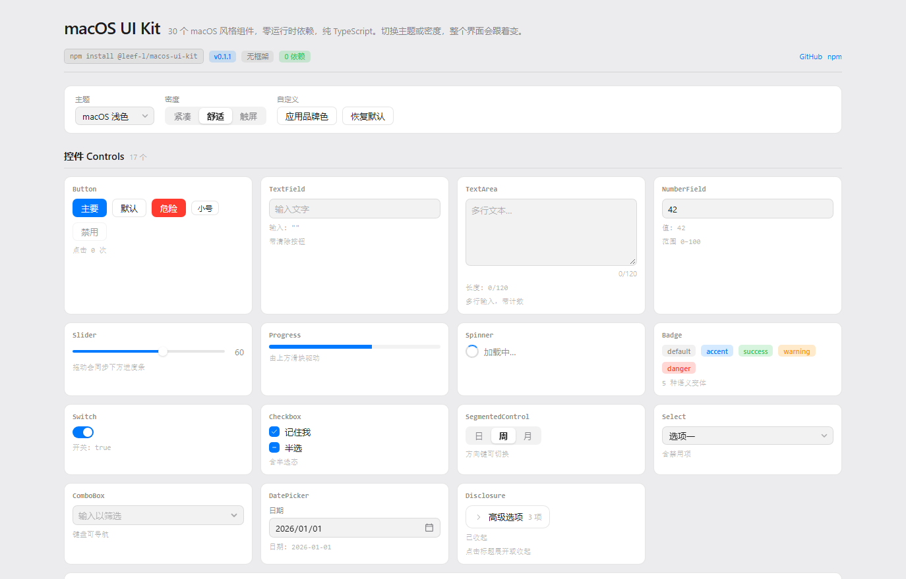
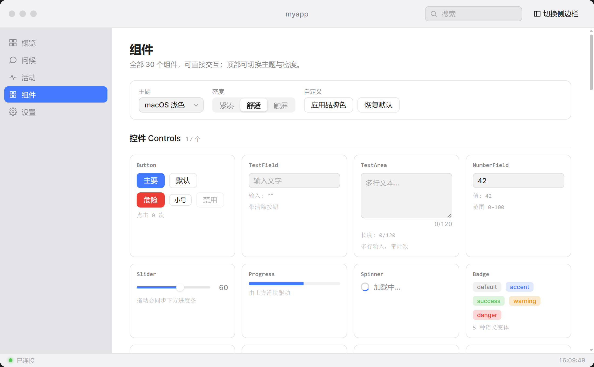

# macOS UI Kit

**30 个 macOS 风格组件，纯 TypeScript，零运行时依赖。** 没有 React，没有 Vue，
没有虚拟 DOM —— 只用 DOM API 加两层设计 token，支持运行时主题与密度缩放。

**在线预览 → <https://leef-l.github.io/macos-ui-kit/>**

[](https://www.npmjs.com/package/@leef-l/macos-ui-kit)
[](https://leef-l.github.io/macos-ui-kit/)
[](./LICENSE)

**English** | 简体中文



---

## 独立使用，不需要 Wails

这个包就是一套前端组件。**不需要 Go，不需要 Wails，不需要任何后端。**

`package.json` 里 `dependencies` 和 `peerDependencies` 都是空的；打包产物没有任何
import；`src/` 里没有一处读取 `_wails` 全局对象、IPC 桥或原生 API。

它能跑在：普通浏览器、Electron、Tauri、Wails 窗口、或者双击打开的 HTML 文件。

Wails v3 是**适配目标**，不是前提条件。凡是涉及宿主行为的地方都用标准 Web API
实现，脱离桌面壳时静默失效而不是报错：

| 行为 | 实现方式 | 桌面壳之外 |
|---|---|---|
| 窗口拖拽 | 标题栏上的 `--wails-draggable` CSS 属性 | 被忽略 |
| 双击缩放 | `dblclick` 监听 | 什么都不做 |
| 移动端探测 | `matchMedia("(pointer: coarse)")` | 到处都能用 |
| 侧边栏 / 浮层 | 纯 DOM + CSS | 到处都能用 |

本仓库里的 Go 代码是**演示宿主**，不属于这个包。

| | 发给使用者 | 需要 Go | 需要 Wails |
|---|---|---|---|
| `packages/macos-ui-kit` | 是 | 否 | 否 |
| 演示应用 | 否 | 是 | 是 |

---

## 快速开始

```sh
npm install @leef-l/macos-ui-kit
```

```ts
import {Button, TextField, showToast} from "@leef-l/macos-ui-kit";
// JS 产物不含 CSS，样式表需要单独引入。
import "@leef-l/macos-ui-kit/style.css";

const field = new TextField({placeholder: "你的名字"});
document.body.appendChild(field.element);

const button = new Button({
    label: "问候",
    variant: "primary",
    onClick: () => showToast(`你好 ${field.value}`),
});
document.body.appendChild(button.element);
```

每个组件都暴露 `element`，那就是你要挂载的节点。构造它、append `element`、
保留实例以便调用方法。

### 完全不用构建工具

从 [Release](https://github.com/leef-l/macos-ui-kit/releases) 下载
`dist/macos-ui-kit.iife.js`、`dist/macos-ui-kit.css` 和 `dist/assets/`，
放在你的 HTML 旁边，使用全局变量 `MacUI`：

```html
<link rel="stylesheet" href="./macos-ui-kit.css" />
<script src="./macos-ui-kit.iife.js"></script>
<script>
    document.body.appendChild(
        new MacUI.Button({label: "你好", variant: "primary"}).element,
    );
</script>
```

### 其他安装渠道

| 渠道 | 命令 | 说明 |
|---|---|---|
| **npm** | `npm install @leef-l/macos-ui-kit` | 推荐。零配置、不需要 token。 |
| **Release tarball** | `npm install https://github.com/leef-l/macos-ui-kit/releases/download/v0.1.1/leef-l-macos-ui-kit-0.1.1.tgz` | 锁定精确构建；不经过任何 registry。 |
| **GitHub Packages** | `npm install @leef-l/macos-ui-kit`，配 `@leef-l:registry=https://npm.pkg.github.com` | 即使是公开包也**需要 token**。 |

包级别的文档见 [`packages/macos-ui-kit/README.zh-CN.md`](packages/macos-ui-kit/README.zh-CN.md)。

---

## 组件清单

| 分组 | 组件 |
| --- | --- |
| **控件（17）** | Button、TextField、TextArea、NumberField、Slider、Progress、Spinner、Badge、Switch、Checkbox、SegmentedControl、Select、ComboBox、DatePicker、Disclosure、Table、SplitView |
| **布局（6）** | TitleBar、TrafficLights、Sidebar、StatusBar、Toolbar、TabView |
| **浮层（6）** | Menu、Tooltip、Dialog、Popover、Sheet、Toast |
| **移动端（1）** | MobileShell |

去 <https://leef-l.github.io/macos-ui-kit/> 直接试，页面顶部可以切换主题和密度。

## API 约定

三条规则，贯穿全部 30 个组件，让你没用过的控件也符合直觉：

| 关注点 | 规则 | 示例 |
|---|---|---|
| **读状态** | 属性 getter | `field.value`、`toggle.checked`、`sidebar.selected`、`sheet.isOpen` |
| **写状态** | `setX()`，一律静默 | `setValue()`、`setChecked()`、`setSelected()` |
| **可关闭浮层** | `open(anchor?)` / `close()` / `isOpen` | `dialog.open()`、`menu.open(btn)`、`popover.open(btn)` |

```ts
const field = new TextField();
field.setValue("hello");   // 静默：不会触发 onChange
field.value;               // "hello"

const sheet = new Sheet({title: "许可"});
sheet.open();              // 不是 show()
sheet.isOpen;              // true
```

两个刻意的设计：

- **`setX()` 永远不触发变更回调**，只有用户交互才触发。这样从渲染路径里调用
  是安全的，不会回环进你自己的 handler。
- **`Toast` 保留 `show()` / `hide()`**。它是通知，不是浮层：没有锚点、没有
  关闭状态、没有 `isOpen`。

每个组件还暴露 `element`、`destroy()`（释放监听器与 observer）、以及适用时的
`focus()`。

## 主题

```ts
import {themeManager, setDensity} from "@leef-l/macos-ui-kit";

themeManager.apply("macos-dark");   // macos-dark | macos-light | hc-dark | hc-light
setDensity("compact");              // compact | comfortable | touch
```

或者在你自己的样式表里覆盖 token —— 组件只读语义层 token，改一处就能换掉全局：

```css
:root {
    --mac-accent: #7c5cff;
    --mac-radius-m: 10px;
}
```

### 两层 token

```
基础层    原始值      --mac-base-gray-950  --mac-base-blue-D
     ↓
语义层    用途命名    --mac-bg-window  --mac-accent
     ↓
组件      只读这一层  background: var(--mac-bg-window)
```

组件从不引用基础层 token。这层间接性让一个主题只需覆盖三个值，而不是六十个。

内置主题是纯 CSS，所以首帧就是正确的 —— 不会闪一下错误的主题。密度预设移动
一个 `--mac-scale` 因子，所有可缩放尺寸都乘它；粗指针设备自动获得更宽松的预设。

### 为什么不用框架

这套组件面向的是交互较轻的窗口外壳 —— 设置面板、列表、表单。这正是框架运行时
开销纯属负担、而它的优势（为大列表做虚拟 DOM diff）用不上的场景。代价是状态同步
和事件委托要手写，所以库里强制执行了几条规则：委托监听、`DocumentFragment`
批量插入、幂等 setter。

完整架构与每个决策的理由（包括被否掉的方案）见
[`DESIGN-v2.md`](packages/macos-ui-kit/src/DESIGN-v2.md)。

---

## 预览站

<https://leef-l.github.io/macos-ui-kit/>

showcase 在纯浏览器里运行，没有 Go、没有 Wails、运行时不需要打包器。它和库用
同一份源码构建：

| 文件 | 作用 |
|---|---|
| `frontend/preview/index.html` | 页面外壳 |
| `frontend/src/preview.ts` | 挂载 `buildShowcase()` 加页眉页脚 |
| `frontend/src/preview.css` | 页面框架，全用 token |
| `frontend/vite.preview.config.ts` | 独立 Vite root，`base` 为 `/macos-ui-kit/` |
| `.github/workflows/preview.yml` | install → typecheck → build → 部署到 Pages |

`preview.ts` 用**包名**导入组件库，所以这个页面本身就是「库能独立运行」的证明。
每次推送到 `main` 会自动重建，也可以在 Actions 页面手动触发。

---

## 仓库结构

```
packages/macos-ui-kit/   组件库（发布的包）
├─ package.json          name、exports、构建脚本、files 列表
├─ vite.config.ts        库构建：ESM + IIFE + 一份样式表
├─ tsconfig.build.json   只生成类型声明
├─ assets/               Inter 字体 + OFL 许可
├─ scripts/
│  └─ finalize-dist.mjs  构建后处理：外置字体、写 style.css.d.ts
└─ src/
   ├─ tokens.css         两层设计 token
   ├─ base.css           全局元素规则（[hidden]、.visually-hidden）
   ├─ theme.ts           运行时主题管理器
   ├─ fonts.css          跨平台字体归一化
   ├─ scrollbars.css     跨平台滚动条归一化
   ├─ touch.css          无 hover 归一化
   ├─ component.ts       基类（监听器生命周期）
   ├─ dom.ts             元素构造器
   ├─ overlay.ts         定位、焦点陷阱、层级
   ├─ controls/          17 个控件
   ├─ layout/            6 个布局组件
   ├─ overlays/          6 个浮层
   └─ mobile/            移动端外壳

frontend/                演示应用（Wails v3，不发布）
├─ preview/              Pages 用的静态预览入口
├─ index.html            桌面窗口的文档外壳
├─ public/style.css      应用层布局
└─ src/
   ├─ main.ts            外壳接线：红绿灯、侧边栏、事件
   ├─ preview.ts         预览页入口
   ├─ showcase/          组件展示
   └─ bindings/          自动生成 —— 不要手改

main.go                  应用与窗口设置
menu.go                  原生菜单栏
windowservice.go         窗口控制服务 + window:state 事件
greetservice.go          演示用的 Go 服务
```

### 为什么应用引用源码而不是 `dist`

`frontend/vite.config.ts` 把 `@leef-l/macos-ui-kit` 别名到
`packages/macos-ui-kit/src/index.ts`，`frontend/tsconfig.json` 在 `paths` 里
做了同样的映射。改组件立刻生效、不需要先构建库，也不会有第二份代码产生漂移。
仓库外的使用者用的是构建后的包。

---

## 演示应用

**环境要求：** Go 1.26+、Node 18+、`wails3` CLI，以及平台 webview
（Windows 用 WebView2，macOS 用 WebKit，Linux 用 WebKitGTK）。

```sh
wails3 dev      # 开发模式，热重载
wails3 build    # 产出二进制到 bin/
```



窗口是无边框的（`Frameless: true`），原生标题栏隐藏。整个框架由应用自己绘制，
这也是各平台界面完全一致的原因。

| macOS 元素 | 位置 |
| --- | --- |
| 红绿灯 | `packages/macos-ui-kit/src/layout/traffic-lights.*` |
| 可拖拽标题栏 | `.mac-titlebar`，通过 `--wails-draggable: drag` |
| 源列表侧边栏 | `packages/macos-ui-kit/src/layout/sidebar.*` |
| 工具栏搜索 | 标题栏尾部簇里的 `TextField` |
| 状态栏 | `packages/macos-ui-kit/src/layout/statusbar.*` |

`windowservice.go` 把窗口控制暴露给前端；导出的方法会变成返回 Promise 的
TypeScript 函数。因为没有原生边框可依赖，绘制的红绿灯就是窗口唯一的关闭、
最小化、缩放控件。该服务同时订阅原生窗口事件并通过 `window:state` 推送状态，
所以从应用外部改变窗口（比如双击标题栏）时，红绿灯也能保持正确。

### 每个组件用在哪

演示应用把整套库都用起来了，而不是只在一个画廊页里展示 —— 只在目录里渲染过的
组件，往往会以目录无法暴露的方式出错：

| 分区 | 实际用到的组件 |
|---|---|
| 概览 | `TextField`、`Button`、`ComboBox`、`TextArea`、`Menu`、`Tooltip`、`Badge` |
| 问候 | 消息历史列表，由概览页同一套控件驱动 |
| 活动 | `SegmentedControl`、`Table`、`Badge`、`Spinner`、`Progress`、`Button` |
| 设置 | `TabView`、`SegmentedControl`、`Slider`、`Checkbox`、`Switch`、`Select`、`NumberField`、`DatePicker`、`Disclosure`、`Dialog` |
| 组件 | 展示页里的全部 30 个，加上 `Toolbar`、`SplitView`、`Popover`、`Sheet` 组成的检查器 |

`TrafficLights` 由 `TitleBar` 内部创建，`Toast` 通过 `showToast()` 触发，
所以两者在 `main.ts` 里都不会出现 `new` 调用。

### 平台差异，如实说明

| 关注点 | 实际情况 |
| --- | --- |
| **字体** | macOS/iOS 通过 `-apple-system` 用真正的 SF Pro。Windows/Linux 回退到 **Inter**（SIL OFL），刻意做成 SF 的形状。精确的字形一致不可能做到：SF Pro 是 Apple 授权字体，不能再分发。 |
| **渲染的界面** | 布局、间距、圆角、颜色完全一致。滚动条渲染和原生表单控件默认样式各引擎不同，库里替换了关键的部分。 |
| **菜单栏** | macOS 有系统级菜单栏，无法在 webview 里绘制，所以 `menu.go` 定义了原生菜单（⌘Q、⌘W、⌘M、⌘,）。Windows/Linux 禁用它，改用侧边栏。**任何平台都不会出现两套导航。** |
| **窗口圆角** | macOS 上 AppKit 已经会给无边框窗口加圆角，所以 CSS 圆角在那里让位。Windows/Linux 自己绘制。 |
| **移动端** | 移动外壳追求的是*可用性* —— 安全区、44px 触控目标、不依赖 hover —— 而不是与 iOS HIG 做像素级对齐。 |

### 类型检查与绑定

```sh
cd frontend && npm run typecheck
```

TypeScript 需要 5.0 以上：`tsconfig.json` 用了 `moduleResolution: "bundler"`
和 `verbatimModuleSyntax`。

`frontend/bindings/` 由 Go 服务自动生成。改动导出的服务方法后需要重新生成
（`wails3 build` 会自动做）：

```sh
wails3 generate bindings -f "-tags production" -clean=true -ts -i
```

---

## 发布

三个目标，刻意分成独立步骤 —— 镜像失败不应该让 npm 停在一个别人拿不到的版本上。

```powershell
cd packages/macos-ui-kit
npm version patch        # 或 minor / major；会更新 package.json 并打 tag

# 1. npm registry。需要验证器 App 的一次性验证码：发布是写操作，
#    账号对写操作开启了 2FA。
npm publish --otp=<code>

# 2. GitHub Packages。需要带 write:packages 的 token ——
#    `gh auth refresh -s write:packages` 可以给 gh 自己的 token 加上。
npm publish --registry=https://npm.pkg.github.com

# 3. GitHub Release，让包不经过任何 registry 也能安装。
npm pack
gh release create v0.1.2 leef-l-macos-ui-kit-0.1.2.tgz --title "macOS UI Kit v0.1.2" --notes "..."
```

首次发布踩到的两个坑：

- **决定发布目标的是 `publishConfig.registry`，不是全局的 `npm config registry`。**
  这台机器的全局 registry 是只读的 npmmirror，发布照样成功，因为 `package.json`
  里锁定了 `registry.npmjs.org`。
- **绕过 2FA 的 token 不是密码。** 单独设置 `NODE_AUTH_TOKEN` 没有任何作用：
  `.npmrc` 必须引用它，或者把 token 写进配置文件用 `--userconfig` 传进去。
  否则 npm 会回退到已登录的账号，发布被 `EOTP` 拒绝 —— 看起来像 token 坏了，
  实际上它根本没被用上。

---

## 验证

```sh
go vet ./...
gofmt -l *.go
cd packages/macos-ui-kit && npm run build     # 库：dist + 类型 + CSS
cd frontend && npx tsc --noEmit && npm run build
wails3 build
```

库构建不是可选项：它是证明这个包能独立存在的环节。它抓到过两个应用构建抓不到的缺陷：

- **整个设计系统被 tree-shake 掉了。** 包清单里的 `sideEffects` 没有包含入口
  文件，打包器就把 `src/index.ts` 顶部的样式表 import 全丢了，发出 53 KB 组件
  CSS 却没有 token、没有字体、没有全局规则。应用能渲染 —— 但完全没样式。
- **字体被内联成 base64。** Vite 库模式无视 `assetsInlineLimit` 内联 CSS 资源，
  63 KB 的样式表变成 473 KB。`scripts/finalize-dist.mjs` 把字体重新写成独立文件。

组件库还会在**完全没有宿主**的情况下验证：一个纯 HTML 文件，静态服务器提供，
没有打包器、没有 Go 进程、没有 Wails 运行时。它用 `<script>` 标签加载
`macos-ui-kit.iife.js`，通过 `window.MacUI` 挂载全部 30 个组件。断言包括 30/30
挂载成功、零控制台错误、`window._wails === undefined`、以及 token 正常解析
（`--mac-control-height` → `calc(28px * 1)`）。这是「不需要后端」这件事的证据，
写在文档里不算证据。

验证的是行为，不只是存在：`Table.setRows()` 会重渲染、`Progress.setValue()`
会移动填充、`TabView.setSelected()` 会切换标签、`Disclosure` 会展开收起、
四套主题产生不同背景色、密度预设会改变 `--mac-scale`。

其中两项是回归测试，抓到的缺陷单靠目录页发现不了：

- **`[hidden]` 被忽略。** 组件根元素设置 `display` 会盖掉浏览器默认的
  `[hidden] { display: none }`，所以对 `Spinner` 设置 `element.hidden = true`
  它依然可见。现在 `base.css` 一次性修掉了这一类问题。
- **`Disclosure` 箭头方向反了。** 图标路径在 `0deg` 时本身就是右向箭头，但样式
  让收起态旋转 `-90deg`（变成朝上）、展开态 `0deg`（变成朝右）。

打包产物也会从外部验证：一个临时项目从 registry 安装、用发布出来的 `.d.ts`
做类型检查、用自己的 Vite 打包、再在无头浏览器里加载，确认组件挂载**且** token
生效。已部署的预览站也是同样方式验证的，只是直接打线上 URL。

---

## 许可

MIT。捆绑的第三方资源保持各自许可：

- **Inter** 字体 —— SIL Open Font License 1.1
  （见 `packages/macos-ui-kit/assets/Inter Font License.txt`）
- **Wails** —— MIT
